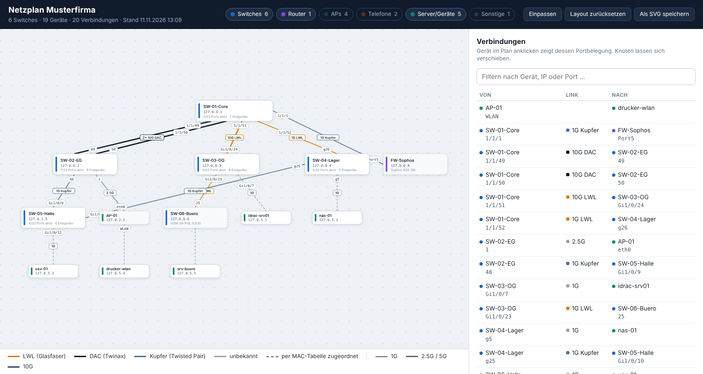

# LLDP-Netzplan

[← Zur Übersicht aller Tools](../../README.md)

Fragt Switche per SNMP ab, liest deren LLDP-Nachbarn aus und erzeugt daraus einen Netzwerkplan: welcher Switch hängt über welchen Port an welchem anderen, mit welcher Geschwindigkeit und über welches Medium (z. B. `10G LWL`, `10G DAC`, `1G Kupfer`). Das Tool liest nur und ändert nichts an den Geräten.

Zusätzlich wertet es die MAC-Tabellen der Switche aus: SNMP-Geräte ohne LLDP (Server, iDRAC, NAS, USV …) werden an ihrem Switch-Port eingezeichnet, und je Switch gibt es eine Zählung der aktiven Ports und der angeschlossenen Endgeräte.

Es arbeitet über die Standard-LLDP-MIB und ist damit herstellerunabhängig (Aruba CX, ArubaOS-Switch/ProCurve, Instant On, Cisco, Comware, Netgear …).



## Inhalt

- [Voraussetzungen](#voraussetzungen)
- [Ausführen](#ausführen)
- [Beispiele](#beispiele)
- [Parameter](#parameter)
- [Ausgabe](#ausgabe)
- [So liest man den Plan](#so-liest-man-den-plan)
- [Geschwindigkeit und Medium](#geschwindigkeit-und-medium)
- [Endgeräte und Portzählung](#endgeräte-und-portzählung)
- [Was das Tool im Netz tut](#was-das-tool-im-netz-tut)
- [Grenzen](#grenzen)
- [Teststand](#teststand)

## Voraussetzungen

- Windows PowerShell 5.1 oder PowerShell 7. Keine Module nötig, SNMP v2c/v1 ist im Skript selbst umgesetzt.
- SNMP-Lesezugriff auf die Switche (UDP 161) vom Admin-PC aus
- LLDP auf den Switchen aktiv

## Ausführen

Das Skript läuft auf einem PC oder Server im Kundennetz, der die Management-IPs der Switche per SNMP erreicht. Es schreibt seine Ergebnisse in den aktuellen Ordner, deshalb zuerst einen Arbeitsordner für den Kunden anlegen.

### Variante A: nur dieses Skript laden

Der schnellste Weg, wenn auf dem Rechner sonst nichts installiert ist:

```powershell
mkdir C:\Kunden\Musterfirma\Netzplan; cd C:\Kunden\Musterfirma\Netzplan
irm https://raw.githubusercontent.com/ichabot/HPEArbua/main/tools/LLDP-Netzplan/Get-LldpTopology.ps1 -OutFile Get-LldpTopology.ps1
Set-ExecutionPolicy -Scope Process -ExecutionPolicy Bypass
.\Get-LldpTopology.ps1 192.168.10.0/24 -Name Musterfirma
```

1. Die erste Zeile legt den Arbeitsordner an und wechselt hinein.
2. Die zweite lädt das Skript in diesen Ordner. Derselbe Befehl holt später auch eine neuere Fassung.
3. Die dritte erlaubt Skripte für dieses eine PowerShell-Fenster.
4. Die vierte startet den Lauf. `192.168.10.0/24` durch das Management-Netz der Switche oder die IP des Core-Switches ersetzen.

### Variante B: aus den installierten Tools

Wenn die Tools über [`Install.ps1`](../../README.md#installation-und-update) installiert sind:

```powershell
mkdir C:\Kunden\Musterfirma\Netzplan; cd C:\Kunden\Musterfirma\Netzplan
& "$HOME\Tools\HPEArbua\tools\LLDP-Netzplan\Get-LldpTopology.ps1" 192.168.10.0/24 -Name Musterfirma
```

Für kürzere Aufrufe einen Alias setzen:

```powershell
Set-Alias netzplan "$HOME\Tools\HPEArbua\tools\LLDP-Netzplan\Get-LldpTopology.ps1"
netzplan 192.168.10.0/24 -Name Musterfirma
```

### Variante C: ohne Internet am Kunden-PC

`Get-LldpTopology.ps1` ist eine einzelne Datei ohne Abhängigkeiten. Auf einem anderen Rechner laden, per USB-Stick oder Fernwartung in den Arbeitsordner kopieren, dann:

```powershell
cd C:\Kunden\Musterfirma\Netzplan
Unblock-File .\Get-LldpTopology.ps1
Set-ExecutionPolicy -Scope Process -ExecutionPolicy Bypass
.\Get-LldpTopology.ps1 192.168.10.0/24 -Name Musterfirma
```

### Nach dem Lauf

- `Musterfirma.html` per Doppelklick im Browser öffnen, das ist der Plan.
- Die Konsole zeigt am Ende die Verbindungen zwischen den Switchen und die Zählung je Switch.
- Alle Dateien sind unter [Ausgabe](#ausgabe) beschrieben.

### Wenn kein Gerät antwortet

| Ursache | Abhilfe |
|---|---|
| Andere Community als `public` | `-Snmp <name>` angeben, mehrere mit Komma |
| SNMP nur von bestimmten Adressen erlaubt (ACL, Management-VLAN) | Skript von einem zugelassenen Rechner starten oder die Adresse am Switch freigeben |
| Sehr altes Gerät | `-V1` probieren |
| Gerät antwortet, zeigt aber 0 LLDP-Nachbarn | LLDP am Gerät prüfen |

Beim ersten Einsatz in einer Umgebung mit einem einzelnen Switch beginnen:

```powershell
.\Get-LldpTopology.ps1 192.168.10.1 -NoCrawl
```

## Beispiele

Als Ziel reicht ein Netz oder ein einzelner Core-Switch. Switche, die ein abgefragtes Gerät per LLDP als Nachbarn meldet, werden automatisch mit abgefragt, auch wenn sie in einem anderen Netz liegen.

```powershell
# Ganzes Management-Netz absuchen
.\Get-LldpTopology.ps1 192.168.10.0/24 -Name Musterfirma

# Start am Core, zwei Communities probieren
.\Get-LldpTopology.ps1 10.0.0.1 -Snmp public,kunde123 -Name Musterfirma

# Mehrere Netze und einzelne Adressen
.\Get-LldpTopology.ps1 192.168.10.0/24,192.168.20.0/24,10.0.0.1 -Name Musterfirma

# Nur die genannten Geräte, ohne Nachziehen der Nachbarn
.\Get-LldpTopology.ps1 10.0.0.1,10.0.0.2 -NoCrawl

# Nur die LLDP-Topologie, ohne MAC-Tabellen (schneller)
.\Get-LldpTopology.ps1 192.168.10.0/24 -NoMacTable

# Ergebnis in einen anderen Ordner schreiben
.\Get-LldpTopology.ps1 192.168.10.0/24 -Name Musterfirma -OutDir C:\Kunden\Musterfirma\Netzplan
```

## Parameter

| Parameter | Bedeutung | Standard |
|---|---|---|
| `-Target` | IP-Adressen, Hostnamen oder Netze in CIDR-Schreibweise (`/16` bis `/32`), mehrere mit Komma | Pflicht |
| `-Snmp` (lang: `-Community`) | SNMP-Community. Mehrere werden der Reihe nach probiert. | `public` |
| `-Name` | Titel des Plans und Präfix der Ausgabedateien | `netzplan` |
| `-OutDir` | Zielordner für die Ausgabe | aktueller Ordner |
| `-NoCrawl` | per LLDP gefundene Nachbar-Switche nicht automatisch abfragen | aus |
| `-IncludeEndpoints` | Access Points, Telefone und sonstige Nachbarn auch in die draw.io-Datei aufnehmen | aus |
| `-NoMacTable` | MAC-Tabellen nicht auswerten: schneller, dafür ohne Endgeräte-Zuordnung und Zählung | aus |
| `-V1` | SNMP v1 statt v2c | aus |
| `-TimeoutMs` / `-Retries` | Wartezeit je Anfrage und Anzahl Wiederholungen | `1500` / `1` |
| `-Port` | SNMP-Port | `161` |

Mehrere Communities funktionieren beim Aufruf in der PowerShell-Konsole. Bei `powershell.exe -File …` kommt `a,b` als eine einzige Community an.

## Ausgabe

Alle Dateien landen im aktuellen Ordner bzw. in `-OutDir`:

| Datei | Inhalt |
|---|---|
| `<Name>.html` | Interaktiver Plan für den Browser, läuft offline. Knoten verschieben, zoomen, Klick auf ein Gerät zeigt dessen Portbelegung. APs, Telefone und Sonstiges sind einblendbar. Export als SVG. |
| `<Name>.drawio` | Derselbe Plan zum Nachbearbeiten in draw.io / diagrams.net |
| `<Name>_links.csv` | Gerät A, Port A, Port B, Gerät B, Link-Typ (Geschwindigkeit, Medium, Detail wie `10GBASE-SR` oder `SFP+DAC3`) und ob beide Seiten den Link gemeldet haben |
| `<Name>_devices.csv` | Alle gefundenen Geräte mit IP, Typ, Chassis-ID und Beschreibung |
| `<Name>_switches.csv` | Je Switch: Ports gesamt, Ports aktiv, Ports mit Endgerät, Anzahl Endgeräte (MAC-Adressen), davon hinter Access Points |
| `<Name>_endgeraete.csv` | Jede MAC-Adresse mit Switch, Port, IP, Name (soweit bekannt) und Hinweis |

Die Ausgabe enthält Kundendaten und gehört in den Arbeitsordner des Kunden. Die `.gitignore` blockt `*.html`, `*.drawio` und `*.csv` im Repository.

## So liest man den Plan

- Jede Linie ist ein LLDP-Nachbarschaftsverhältnis, die Beschriftung an den Enden nennt den Port auf der jeweiligen Seite.
- In der Mitte der Linie steht der Link-Typ, z. B. `10G LWL`. Die Farbe zeigt das Medium, die Strichstärke die Geschwindigkeit; die Legende steht unter dem Plan.
- Mehrere Linien zwischen zwei Geräten sind einzelne physische Links, typischerweise ein LAG. Sind sie gleichartig, tragen sie eine gemeinsame Beschriftung wie `2× 10G DAC`.
- Gestrichelte Linien sind Zuordnungen aus der MAC-Tabelle, durchgezogene stammen aus LLDP.
- Unter dem Namen eines Switches stehen aktive Ports und Endgeräte, z. B. `31/52 Ports aktiv · 87 Endgeräte`. Ein Klick auf den Switch listet die MAC-Adressen je Port.
- Gestrichelte Geräte wurden von einem Nachbarn per LLDP gemeldet, haben selbst aber nicht auf SNMP geantwortet. Der Port auf deren Seite stammt dann aus der Meldung des Nachbarn.
- Der Gerätetyp (Switch, Router/Firewall, Access Point, Telefon) kommt aus den LLDP-Capabilities.

## Geschwindigkeit und Medium

Für jeden Port mit LLDP-Nachbar fragt das Tool zusätzlich ab:

| Angabe | Quelle |
|---|---|
| Geschwindigkeit | IF-MIB `ifHighSpeed`, ersatzweise `ifSpeed`. Das ist die ausgehandelte Geschwindigkeit. |
| Medium, erste Wahl | Typ des gesteckten Transceivers aus den HPE-MIBs: `HP-ICF-TRANSCEIVER-MIB` (ArubaOS-Switch/ProCurve) und `ARUBAWIRED-PM-MIB` (AOS-CX) |
| Medium, zweite Wahl | MAU-Typ des Ports aus der LLDP-802.3-Erweiterung oder der MAU-MIB, z. B. `1000BASE-T`, `10GBASE-SR` |
| Medium, dritte Wahl | MAU-Typ, den der Nachbar per LLDP für sein Ende meldet |

Daraus wird eine dieser Angaben:

| Angabe | Bedeutung |
|---|---|
| `LWL` | Glasfaser (SR, LR, SX, LX, BiDi …) |
| `DAC` | Direct-Attach-Kabel (Twinax) |
| `AOC` | aktives optisches Kabel |
| `Kupfer` | Twisted Pair (RJ45) |
| `SFP` | steckbares Modul, Medium nicht erkennbar |
| ohne Zusatz | das Gerät liefert keine Angabe zum Medium |

Der Standard kennt für 10G-DAC in SFP+-Ports keinen eigenen MAU-Typ. `10G DAC` erscheint deshalb nur, wenn der Switch den Transceiver-Typ über eine der beiden HPE-MIBs liefert. Bei anderen Herstellern steht an solchen Links `10G SFP`. Ab 25G gibt es eigene MAU-Typen für DAC.

Melden beide Enden gleich verlässlich unterschiedliche Medien (z. B. Medienkonverter), stehen beide im Plan: `1G LWL/Kupfer`.

## Endgeräte und Portzählung

Das Tool liest von jedem Switch die MAC-Tabelle (Q-BRIDGE-MIB, ersatzweise BRIDGE-MIB), den Portstatus, die eigenen MAC-Adressen und die ARP-Tabelle. Dazu kommt der ARP-Cache des PCs, auf dem das Skript läuft.

Jede MAC-Adresse wird netzweit genau einem Switch-Port zugeordnet, damit nichts doppelt zählt:

1. Ports, hinter denen laut LLDP ein abgefragter Switch hängt, sind Uplinks und scheiden aus. Das gilt auch für das zugehörige LAG-Interface.
2. Unter den übrigen Ports, an denen die MAC zu sehen ist, gewinnt der mit den wenigsten MAC-Adressen. Am Anschlussport steht ein Gerät allein, auf Durchgangsports stehen viele.
3. Ist eine MAC nur an Uplinks zu sehen, wird sie dem Switch am Ende der Kette zugeschrieben, mit Port `?`.
4. Die MAC-Adressen der Switche selbst zählen nicht mit.

Die Spalte `Hinweis` in der Endgeräte-Liste sagt, was an einem Port los ist:

| Hinweis | Bedeutung |
|---|---|
| `LLDP-Nachbar` | das Gerät, das sich an diesem Port per LLDP meldet (AP, Telefon, Server) |
| `WLAN, hinter <AP>` | WLAN-Client am Access Point dieses Ports |
| `hinter <Gerät>` | hängt hinter einem LLDP-Nachbarn, z. B. PC am Telefon oder Gerät an einem nicht abgefragten Switch |
| `n MACs an diesem Port` | mehrere Geräte ohne LLDP-Nachbar: unmanaged Switch, Host mit VMs oder ein LAG ohne LAG-MIB |

Für die Portzählung heißt das: `PortsAktiv` kommt direkt aus dem Portstatus der Ethernet-Ports. `Endgeraete` zählt MAC-Adressen und liegt deshalb höher als die Zahl belegter Ports, sobald WLAN-Clients, VMs oder unmanaged Switche im Spiel sind. `PortsMitEndgeraet` und `DavonWLAN` helfen beim Einordnen.

Abgefragte SNMP-Geräte ohne LLDP-Verbindung bekommen im Plan eine gestrichelte Linie zu ihrem Port. Hängt so ein Gerät hinter einem Access Point oder einem nicht abgefragten Switch, führt die Linie dorthin.

## Was das Tool im Netz tut

- Es sendet ausschließlich SNMP-Leseanfragen (Get, GetNext, GetBulk). Ein schreibendes Set ist im Skript nicht enthalten. Konfiguration ändern, Geräte neu starten oder etwas löschen kann es damit nicht.
- Beim Absuchen eines Netzes bekommt jede Adresse ein kleines UDP-Paket auf Port 161. Antwortende Geräte werden danach nach LLDP-, Interface- und MAC-Tabellen gefragt, wie es ein Monitoring-System auch tut.
- Auf dem PC schreibt es nur die Ausgabedateien in den Arbeitsordner. Gleichnamige Dateien eines früheren Laufs werden überschrieben.
- Ein IDS oder eine Firewall mit Scan-Erkennung kann das Absuchen eines ganzen Netzes melden. Wer das vermeiden will, gibt nur die IP des Core-Switches an.
- Sehr alte oder einfache Geräte mit fehlerhaftem SNMP-Agent können auf Abfragen mit kurzzeitig erhöhter CPU-Last reagieren.

## Grenzen

- Ohne LLDP keine Nachbarn. Geräte, die nur CDP sprechen, tauchen ohne Verbindungen auf.
- SNMP v3 wird nicht unterstützt.
- MAC-Tabellen sind eine Momentaufnahme. Geräte, die länger nichts gesendet haben, sind ausgealtert und fehlen in der Zählung.
- Cisco IOS liefert die MAC-Tabelle per SNMP nur je VLAN (Community `name@vlan`). Abgefragt wird nur die Standard-Sicht; Geräte in anderen VLANs erscheinen dann am vorgelagerten Switch mit Port `?`.
- Ein Gerät mit mehreren MAC-Adressen (Server mit mehreren NICs, VM-Host) zählt mehrfach.
- Unmanaged Switche und Medienkonverter sind für LLDP unsichtbar. Hängen zwei Switche über so ein Gerät zusammen, zeigt der Plan sie als direkt verbunden.
- Portnamen werden so übernommen, wie das Gerät sie per LLDP meldet. Lange Namen wie `GigabitEthernet1/0/1` werden zu `Gi1/0/1` gekürzt.

## Teststand

- **Echte Hardware:** Topologie und Link-Typen liefen in einer Umgebung mit ArubaOS-Switch-Geräten und lieferten dort Angaben wie `10G DAC` und `10G LWL`.
- **Simulation:** Alles, auch die MAC-Auswertung, ist unter PowerShell 7 gegen simulierte Switche getestet (v2c und v1): mit verschiedenen Port-Namensschemata, LAG, Ring, unmanaged Switch, WLAN-Clients und nicht abgefragten Switchen. Dort stimmt die Zuordnung aller MAC-Adressen mit dem Soll überein.
- **Offen:** Die MAC-Zuordnung und die Portzählung sind an echter Hardware noch nicht gegen eine bekannte Belegung geprüft.

Die Medium-Erkennung ordnet die Typbezeichnungen der Transceiver (`SFP+SR`, `SFP+DAC3`, `1000SX` …) per Mustererkennung ein. Welche Texte ein bestimmter Switch tatsächlich liefert, zeigt die Spalte `Detail` in der Link-CSV.
